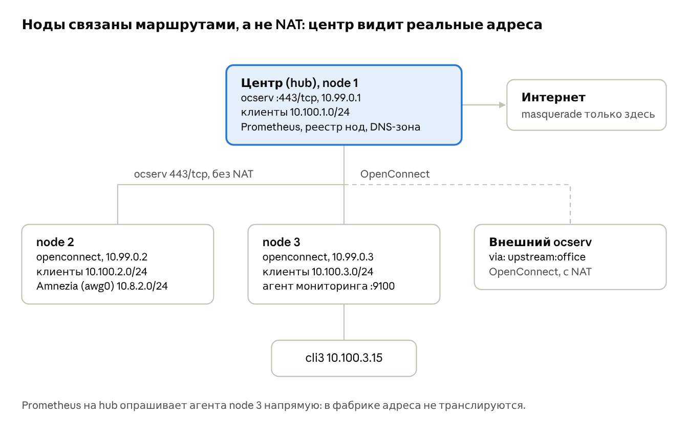
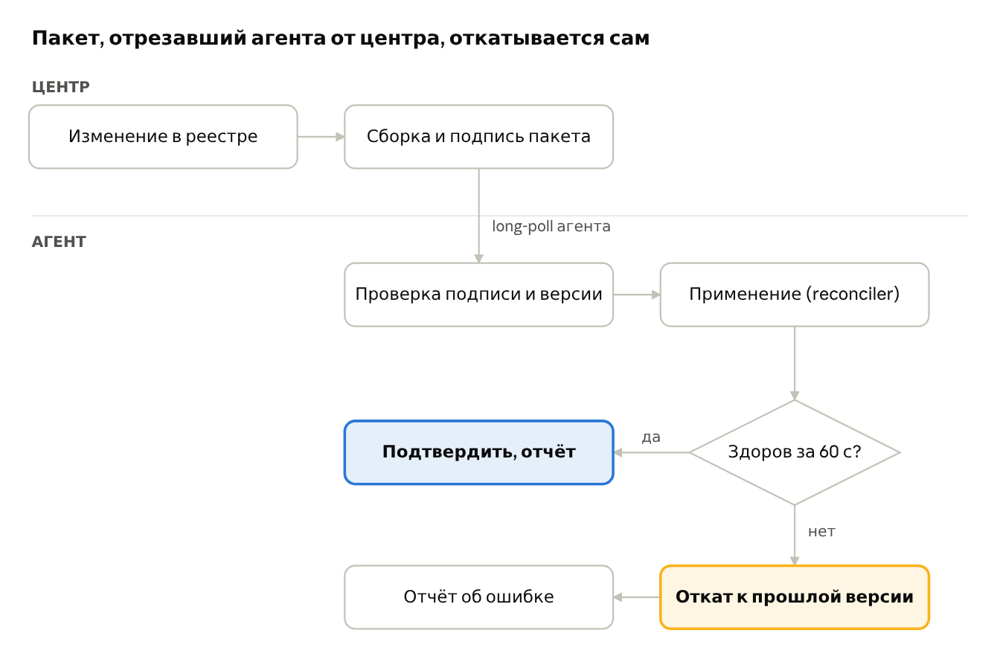

# kornode: план переработки маршрутизации

Oct 11, 2026 · @Vitto

## Резюме

Проблемы kornode — не набор отдельных багов, а следствие трёх архитектурных решений; точечные доработки их не устранят, поэтому план меняет модель, а не добавляет флаги.

1. **Нет адресного плана.** Каждая нода по умолчанию поднимает одну и ту же сеть `10.10.10.0/24` и вешает `10.10.10.1` на `lo`. Как только нода одновременно сервер и клиент другой ноды, адреса центра становятся локальными, а весь трафик в `10.10.10.0/24` принудительно сбрасывается с метки (`meta mark set 0`) и не идёт в туннель.
2. **Межузловая связь построена на NAT, а не на маршрутизации.** Каждый переход через upstream маскарадится, поэтому центр не видит клиентов и агентов за нодами, а обратного маршрута к ним нет. Мониторинг по модели pull (Prometheus → агент) в такой схеме не работает в принципе.
3. **Политика маршрутизации собирается императивно из многих независимых ручек** (`client_policy`, `host_policy`, `host_split`, маршруты профиля, host-маршруты профиля, pushed-маршруты, активный профиль) с правилом «последняя метка выигрывает» и применяется из 5+ мест кода. Ядерные предпосылки (`rp_filter`, `src_valid_mark`, forwarding, MSS) не управляются вовсе.

**Что меняем:**

- **Переходим на модель «центр + агенты».** Центр хранит реестр и единственную истину о сети, компилирует для каждой ноды подписанный пакет желаемого состояния. Нода превращается в минималистичного агента: openconnect, reconciler и отчёт о состоянии, без панели и собственной конфигурации.
- **Центр делит участников на три класса:** клиенты (люди и устройства), агенты (ноды) и внешние серверы (чужие VPN). У каждого класса своя аутентификация, адресация и политика NAT.
- **Сеть не зависит от управления.** Агент применяет пакет через «подтверждение или откат», хранит последнюю рабочую версию и продолжает работать, если центр недоступен.
- Оставляем **ocserv на 443/tcp как транспорт между нодами**, но делаем его маршрутизируемой фабрикой: у агента фиксированный адрес (`explicit-ipv4`), его сети объявляются через `iroute`, NAT внутри фабрики нет.
- Внешние серверы доступа (wg-easy с Amnezia и подобные) подключаются к агенту как **именованные источники**: маршрутизацией их клиентов управляет kornode, а не hooks.
- Политика описывается декларативно («кто → куда → через что»), компилируется в одно состояние ядра и применяется одним reconciler'ом — общим кодом для центра и агента.
- Приёмка — интеграционные тесты в network namespaces, включая отказ центра и откат плохого пакета.

## Диагноз

Каждый наблюдаемый симптом сводится к одной из девяти причин ниже; причины 1–4 объясняют большую часть повторяющихся инцидентов.

| # | Причина | Где в коде | Симптом |
| --- | --- | --- | --- |
| 1 | Одинаковая подсеть клиентов на всех нодах | `config/defaults.py`: `ipv4_network: 10.10.10.0/24`; примеры с `sync_url: https://10.10.10.1:8443` | Нода-клиент не достаёт до DNS, панели и сервисов центра: `10.10.10.1` у неё самой на `lo` |
| 2 | Трафик в VPN-подсеть всегда снимается с метки | `nftables.nft.j2`: `ip daddr {{ ipv4_network }} meta mark set 0` в prerouting, prerouting\_protected и output | Пакеты к адресам центра уходят в main table, а не в туннель |
| 3 | NAT на каждом переходе, нет обратных маршрутов | `nat postrouting`: `masquerade` для всех целей | Центр не может инициировать соединение к агентам и клиентам за нодой; pull-мониторинг не работает |
| 4 | Таблица политик содержит только `default dev <tun>` | `policy_routing.py`: `ip route replace default dev ... table N` | В режиме `full` трафик клиента к локальным сетям ноды (LAN, docker-bridge с мониторингом) уходит в upstream и режется kill switch |
| 5 | Не управляются `rp_filter`, `src_valid_mark`, `ip_forward` | Ни одного обращения к sysctl в коде | Асимметричные пути и fwmark-маршрутизация молча дропаются строгим `rp_filter` на одних хостах и работают на других |
| 6 | Нет MSS clamping при вложенных туннелях | В шаблонах нет `tcp option maxseg` | HTTPS и крупные ответы зависают у клиентов, которые выходят через upstream (DTLS внутри DTLS) |
| 7 | Нет автоматического исключения адреса upstream-сервера | Комментарий в `host_policy: full` перекладывает это на оператора | Петля маршрутизации: несущее соединение openconnect уходит в собственный туннель |
| 8 | Маршрут в таблице N пропадает при переподключении туннеля | Восстанавливается `ensure()` только на тике watchdog | Окно в несколько секунд, когда трафик дропается kill switch'ем |
| 9 | Много путей применения состояния | `upstream.connect/switch/recover`, `apply_server_routing_if_changed`, `nftables.apply` (static/full), watchdog `ensure` | Состояние ядра дрейфует от конфига, результат зависит от порядка событий |

Про IPv6: сейчас клиенты получают только IPv4-пул, поэтому утечки нет. Но правила для `full` написаны только под `ip saddr`, и при добавлении IPv6-пула kill switch его не покроет — это закладывается в новую модель сразу.

Тесты проекта (около 9 тыс. строк) проверяют рендер шаблонов и вызовы команд, но ни один не поднимает реальную сеть. Поэтому ошибки маршрутизации обнаруживаются только в эксплуатации.

## Целевая архитектура

Ноды образуют одну маршрутизируемую сеть: у каждой свой адресный блок, связь между ними — ocserv на 443/tcp с маршрутами вместо NAT, а решение «куда отправить пакет» принимается одной таблицей правил, которую строит один reconciler.



Сплошные линии — фабрика на ocserv 443/tcp с фиксированными адресами и `iroute`, без NAT; пунктир — внешний VPN, единственное место, кроме выхода в интернет, где остаётся NAT. Клиенты Amnezia на node 2 маршрутизируются kornode так же, как клиенты ocserv.

### Центр и агенты

Центр управляет, агенты пересылают пакеты: потеря центра останавливает изменения, но не трафик.

**Три класса участников на центре.** В ocserv это три группы (`config-per-group`), в панели — три раздела, в реестре — три таблицы.

|  | Клиенты | Агенты | Внешние серверы |
| --- | --- | --- | --- |
| Кто | Люди и устройства | Ноды kornode | Чужие ocserv и VPN |
| Как подключаются | К ocserv центра или агента с ролью `access` | К ocserv центра, группа `agents` | Центр или агент сам дозванивается к ним |
| Аутентификация | Пароль, OTP, сертификат | Только сертификат CA kornode | Учётные данные профиля |
| Адрес | Из пула узла, к которому подключились | Фиксированный `10.99.0.<id>` | Выдаёт удалённая сторона |
| Маршруты | Правила `egress` для класса `clients` | `iroute` своих сетей, `route` на фабрику | Набор `to` правила этого upstream |
| NAT | На выходе в интернет или внешний VPN | Нет | Всегда |

**Состав агента.** Отдельный образ `kornode-agent`, собранный из того же репозитория: общий пакет `kornode.net` (модель состояния, компилятор egress, reconciler на pyroute2 и nftables), клиент control plane, openconnect. Без FastAPI, фронтенда, certbot и управления пользователями. ocserv входит в образ, но запускается только при роли `access`. Локальный интерфейс — `kornode-agent status`, `explain`, `diag`; панели на ноде нет.

**Регистрация.** Администратор создаёт агента на центре и получает одноразовый токен (TTL 1 ч), внутри которого адрес центра, отпечаток его сертификата и секрет. `kornode-agent enroll <токен>` генерирует ключ на ноде, отправляет CSR, получает сертификат (срок 90 дней, автопродление на 2/3 срока) и первый пакет. Закрытый ключ ноду не покидает. Отзыв — через уже существующий CRL ocserv: агент сразу теряет доступ к фабрике и control plane.

**Пакет желаемого состояния.** Центр компилирует для каждого агента один JSON-документ: монотонная версия, роли, адреса, upstream-профили, правила egress, источники, DNS, для роли `access` — пользователи узла (только хэши) и группы. Пакет подписан Ed25519-ключом центра отдельно от TLS, поэтому кэш на диске проверяем и после перезагрузки. Секреты upstream-профилей шифруются на публичный ключ агента.

**Доставка — только pull.** Control API центра слушает служебный адрес фабрики (`10.99.0.1`), а не публичный порт, и требует mTLS сертификатом агента. Агент держит long-poll `GET /api/agent/v1/bundle?since=<версия>` (60 с, ответ 304 без изменений), поэтому изменения доезжают за секунды, а входящие порты на нодах не нужны. Регистрация — единственный запрос через публичный адрес центра.

**Применение с подтверждением.** Агент проверяет подпись, схему и версию, компилирует состояние, применяет его и в течение 60 с проверяет здоровье: доступен ли служебный адрес центра через фабрику, работают ли пробы выходов. Не прошло — откат к предыдущей версии (хранятся три последние) и отчёт об ошибке. Пакет, отрезавший агента от центра, сам откатится — без поездки к серверу.



**Отчёты и команды.** Каждые 30 с и при изменениях агент отправляет: применённую версию, состояние туннелей и источников, счётчики, события дрейфа, ошибки, версии компонентов. Агент без отчёта 90 с помечается offline. Команды центра — фиксированный типизированный набор, забираемый тем же long-poll'ом: `reconnect`, `explain {from, to}`, `collect_diag`, `restart`. Произвольного shell нет.

**Автономность.** При старте агент применяет кэшированный пакет, не дожидаясь центра. Пакет не имеет срока годности, чтобы недоступность центра не превратилась в аварию; ограничен только сроком сертификата, и о нём центр предупреждает за 14 дней. Клиенты узла с ролью `access` аутентифицируются локально и работают без центра.

**Хранение на центре.** Настройки самого центра остаются в YAML. Реестр (агенты, клиенты, внешние серверы, версии пакетов) — в SQLite с миграциями, потому что это изменяемые данные, а не конфигурация. `korctl hub backup` упаковывает реестр, CA и ключ подписи в зашифрованный архив; процедура восстановления описана и проверяется тестом.

**Паритет CLI и веб-панели.** Всё управление центром — агенты, реестр, клиенты, внешние серверы, egress, источники, команды агентам, бэкап — доступно и через `korctl`, и в панели, с одинаковыми возможностями. Обе стороны вызывают одни и те же сервисы. Control plane — отдельный процесс, поэтому работает и при выключенной панели (`web.enabled: false`). Соответствие фиксируется манифестом `parity.yaml` (возможность → команда `korctl` → эндпоинт API → элемент панели с `data-capability`), и тест в CI падает, если у возможности нет одной из трёх сторон.

### Адресный план

Центр выдаёт каждому агенту `node.id` (1–254) при регистрации; все адреса выводятся из него и общего `fabric.cidr`, а не задаются руками. Центр сам — node 1.

| Что | Шаблон | Пример для node.id = 3 |
| --- | --- | --- |
| Адрес ноды в фабрике (`explicit-ipv4` на центре) | `10.99.0.<id>/32` | `10.99.0.3` |
| Пул VPN-клиентов ноды (ocserv) | `10.100.<id>.0/24` | `10.100.3.0/24` |
| Служебный адрес (dnsmasq, панель) | `10.100.<id>.1` | `10.100.3.1` |
| Внешний источник (wg-easy/Amnezia) | `10.8.<id>.0/24` | `10.8.3.0/24` |
| Экспортируемые локальные сети | задаются явно | `192.168.3.0/24` |

Валидатор отклоняет конфиг, если пул или экспортируемая сеть пересекается с пулом другой ноды, с LAN хоста или с сетями Docker. Служебный адрес у каждой ноды уникален, поэтому DNS, панель и `sync_url` центра никогда не «перехватываются» локально.

### Фабрика между нодами

- **Транспорт — ocserv/openconnect на 443/tcp, топология hub-and-spoke**, центр — основной сервер. Каждая нода — обычный пользователь ocserv на центре с сертификатной аутентификацией.
- **Фиксированный адрес и маршруты вместо NAT.** Для пользователя-ноды центр генерирует per-user конфиг: `explicit-ipv4 = 10.99.0.<id>` и `iroute = <пул ноды>`, `iroute = <экспортируемые LAN>`. Маршрут к этим сетям в сессию ноды, пока она подключена, ставит reconciler центра (ocserv сам этого не делает без `route-add-cmd`, spike S-03, D-63). Всем нодам центр пушит `route = <префиксы остальных нод>`, нода принимает их через существующий `accept_server_routes` и кладёт в таблицу выхода «фабрика». Центр видит реальный адрес клиента ноды 3 (`10.100.3.15`), агент на ноде 3 — реальный адрес Prometheus. Маскарад остаётся только на выходе в интернет и в сторону внешних upstream.
- **Особенности TCP-транспорта.** Туннель поверх TCP при потерях страдает от эффекта TCP-over-TCP, поэтому: DTLS разрешается там, где UDP проходит (флаг профиля `transport: tcp | auto`); MSS clamping обязателен; `dpd` и `keepalive` уменьшаются до 15–30 с, чтобы обрыв замечался быстро; переподключение openconnect не должно приводить к утечке (см. `unreachable` ниже).
- **Реестр нод на центре** — источник правды для `node.id`, адресов и экспортируемых сетей. Нода регистрируется одноразовым токеном, получает сертификат и профиль upstream. Это заменяет ручной `sync_url` и `pushed`-маршруты между своими нодами; при изменении реестра центр делает `occtl reload`, и маршруты доезжают при следующем подключении или через существующий `GET /api/client/routing`.
- **Тот же механизм для внешних VPN.** Профиль `upstream:<name>` для чужого ocserv работает как сейчас, но через ту же модель выходов, с NAT.

### Модель политик: кто → куда → через что

Вместо семи ручек — один упорядоченный список правил, **первое совпадение выигрывает**:

```yaml
egress:
  - from: [clients, host]
    to: fabric            # все префиксы фабрики
    via: fabric
  - from: [clients]
    to: { domains: [corp.example.com], routes: [10.60.0.0/16] }
    via: upstream:office
    kill_switch: true
  - from: [clients]
    to: any
    via: local            # или exit:<node-id> — выход через другую ноду
```

`from` — класс источника (`clients`, `host`, `fabric` или именованный внешний источник, см. ниже), `to` — `any`, `fabric`, набор маршрутов или доменов, `via` — `local`, `fabric`, `exit:<node>`, `upstream:<profile>`. Компилятор превращает список в nftables verdict map (`ip daddr vmap`) по одной метке на выход и проверяет правила на «мёртвые» (полностью перекрытые предыдущими).

### Внешние серверы доступа (wg-easy, Amnezia)

WireGuard в системе живёт отдельным сервером, а kornode только решает, куда идёт трафик его клиентов. Сервер объявляется как источник:

```yaml
sources:
  - name: amnezia
    interface: awg0
    cidr: 10.8.3.0/24      # из адресного плана ноды, не пересекается с другими

egress:
  - from: [amnezia]
    to: fabric
    via: fabric
  - from: [amnezia]
    to: any
    via: upstream:office
    kill_switch: true
```

- **Маршрутизацией владеет kornode.** Метки, таблицы, kill switch и NAT для `10.8.3.0/24` ставит reconciler по тем же правилам, что и для клиентов ocserv. В wg-easy отключается собственный `PostUp`-NAT (`WG_POST_UP`/`WG_POST_DOWN` пустые или только `ACCEPT` для forward), иначе два владельца одних и тех же правил снова дадут непредсказуемый результат.
- **Без hooks, которые знают об upstream.** Hooks wg-easy не ссылаются на интерфейс upstream kornode: при переключении профиля или переподключении интерфейс меняется, а hook об этом не знает. Связь «источник → выход» хранится только в `egress`.
- **Требование к развёртыванию.** wg-easy работает в `network_mode: host` (как kornode), чтобы его интерфейс был в той же сетевой среде и проходил через правила kornode. Если интерфейс источника отсутствует, reconciler не создаёт для него правил и пишет предупреждение в `korctl doctor`; трафик из его подсети при этом не может уйти мимо kill switch, так как метка ставится по `iifname` и `ip saddr` одновременно.
- **Сеть источника экспортируется в фабрику**, если указано `export: true`: центр узнаёт её через `iroute`, и клиенты Amnezia на ноде 3 видят мониторинг центра так же, как клиенты ocserv.

### Маршрутизация в ядре

1. `ip rule priority 90: lookup main suppress_prefixlength 0` — подключённые сети, LAN, Docker и фабрика всегда выигрывают у политик. Это закрывает причину 4.
2. `ip rule priority 95: to <адрес upstream-сервера> lookup main` для каждого профиля, адрес разрешается при подключении — несущее соединение openconnect никогда не попадает в собственный туннель (причина 7).
3. `ip rule priority 100+: fwmark <выход> lookup <таблица выхода>`.
4. В каждой таблице выхода: `default dev <tun>` **и** `unreachable default metric 4096`. Если туннель упал, пакет получает ICMP unreachable, а не уходит в main. Это kill switch на уровне маршрутизации, без окна между падением туннеля и тиком watchdog (причина 8). nft-проверка `oifname` остаётся вторым рубежом.

Предпосылки ядра проверяются и выставляются при старте: `ip_forward=1`, `src_valid_mark=1`, `rp_filter=2` на туннельных интерфейсах. Если выставить не удалось, нода не стартует и пишет, что именно не так. MSS clamping (`tcp option maxseg size set rt mtu`) — на всех туннельных интерфейсах в forward и output (причины 5, 6).

### Один reconciler

- Reconciler — библиотека `kornode.net`, общая для центра и агента, и единственный код, который трогает ядро. На агенте её вход — пакет от центра, на центре — его собственный YAML и реестр. API, CLI и watchdog только меняют входные данные и «будят» reconciler.
- Цикл: желаемое состояние = f(пакет или конфиг, факты: какие туннели подняты, разрешённые адреса endpoint'ов) → diff с фактическим → применение. Триггеры — новая версия пакета, события netlink (линк упал, маршрут удалён) и таймер раз в 10 с.
- nftables — одной атомарной транзакцией, как сейчас. `ip rule/route` — через netlink (pyroute2), а не через вызов `ip` с разбором JSON.
- `--dry-run` печатает diff, а `explain --from 10.100.3.15 --to monitoring.kornode.internal:9100` показывает цепочку решений: какое правило egress сработало, какая метка, какая таблица, какой интерфейс и NAT. С центра та же команда запускается на любом агенте через типизированную команду `explain`.

## План по фазам

Шесть фаз; каждая выпускается отдельным релизом и закрывается только по зелёным сценариям из раздела «Тестирование». Фаза 0 даёт облегчение уже на текущей архитектуре.

### Фаза 0. Стабилизация текущей версии (1–2 недели)

Цель — убрать причины 4–8 без смены модели.

- [x] Модуль `sysctl` в старте: `ip_forward`, `src_valid_mark`, `rp_filter=2` для `oc-*`, `vpns*`; при неудаче — понятная ошибка в `korctl doctor`.
- [x] MSS clamping в `forward` и `output` для всех туннельных интерфейсов.
- [x] `ip rule ... lookup main suppress_prefixlength 0` перед fwmark-правилами.
- [x] `unreachable default metric 4096` в каждой таблице цели.
- [x] Автоисключение адресов upstream-серверов (`ip rule to <ip> lookup main`), адреса берутся из разрешения `profile.server` при connect.
- [x] `korctl doctor`: проверка sysctl, пересечений подсетей, наличия маршрутов в таблицах, совпадения версии nft.

Подтверждено netlab-сценариями (`tests/netlab/test_p0_upstream.py`, реальные ocserv/openconnect):
агент в `full` достаёт до своих локальных сетей, после падения туннеля помеченный трафик не уходит
в uplink, несущее соединение не петляет. Не покрыто пока: загрузка 50 МБ через вложенный туннель
с MTU 1500/1400. По ходу netlab нашёл и исправлены три бага `host_policy: full` и конфликт
P0-03 с kill-switch (D-20, D-21).

Готово, когда: агент на хосте ноды в режиме `full` достаёт до docker-сервиса на этой же ноде, перезапуск туннеля не даёт ни одного пакета мимо туннеля, HTTPS через upstream не зависает.

### Фаза 1. Сетевые интеграционные тесты (1–2 недели, параллельно с фазой 0)

- [x] Стенд из network namespaces (описан в разделе «Тестирование»), запуск в CI через привилегированный runner.
- [x] Сценарии, воспроизводящие ваши текущие инциденты, — они должны падать на старой версии и проходить после фазы 0.

Задача `netlab` в CI впервые прошла на GitHub-раннере 2026-10-20 (PR #1). Красный/зелёный на
`raven`/`main` — в `docs/spec/09-testing.md`.

### Фаза 2. Адресный план и ядро `kornode.net` (3–4 недели)

- [x] Пакет `kornode.net`: модель желаемого состояния (sysctl, rules, routes, nft) как чистые данные, компилятор, diff, применение на pyroute2. Без зависимостей от FastAPI и конфиг-модели панели — это будущее ядро агента.
- [x] Reconciler: netlink-подписка, таймер, атомарное применение. Все текущие точки применения (`connect`, `switch`, `recover`, `apply_server_routing_if_changed`, watchdog `ensure`) переводятся на «изменить вход + разбудить reconciler».
- [x] `node.id`, `fabric.cidr`, вывод пулов и служебного адреса; валидатор пересечений.
- [x] `explain` и `--dry-run` с diff.

> Статус (2026-10-13): фаза завершена. Хаб переведён на reconciler (P2-08/P2-09): `NftablesService`, `PolicyRoutingService`, `SysctlService` и шаблоны nft удалены, `UpstreamService`/резолвер доменов/хуки только меняют входы и вызывают `NetService` (синхронный проход по сокету `reconciler.sock`, иначе один проход в процессе), в supervisor — программа `reconciler`. Ядро меняет только `net/kernel.py` (grep-тест `tests/test_kernel_single_writer.py`).

Готово, когда: в коде ровно одно место вызывает nft и меняет rules/routes, ручное удаление маршрута восстанавливается меньше чем за 2 с, а `kornode.net` импортируется без зависимостей панели.

### Фаза 3. Control plane и агент (4–5 недель)

- [ ] Реестр на центре в SQLite с миграциями: агенты, клиенты, внешние серверы, версии пакетов. Три раздела в панели и три группы ocserv.

> Статус (2026-10-14): архитектура P3-04/P3-06 согласована (D-34…D-40, spec 05/06/11). P3-01 — реестр SQLite с миграциями и снапшотами — готов в ветке `redesign/p3-01-registry` (D-41). P3-02 — группы ocserv `clients`/`agents`/`enroll` из реестра — готов в ветке `redesign/p3-02-ocserv-groups` (D-42…D-44; спайки S-01/S-02 прошли, S-04 ушёл на запасной вариант с nft); разделы панели (P3-08) — впереди. P3-03 — регистрация агента (токены, CSR, продление, отзыв через CRL, строгий RPF для сессий ocserv) — готова в ветке `redesign/p3-03-enrollment` (D-45…D-47), уровень сервисов; HTTP-обвязка — P3-05, `korctl agent`/API/панель — P3-08. P3-04 — компилятор пакета (`kornode.bundle`, `BundleService`) — готов в ветке `redesign/p3-04-bundle-compiler` (D-48). P3-05 — Control API (`kornode.control`, mTLS, long-poll, отчёты, команды; `control.*` в конфиге) — готов в ветке `redesign/p3-05-control-api` (D-49…D-52); P3-06 — агент (`kornode_agent`, `kornode.tunnels`, `kornode-agent enroll|run|version`, образ `Dockerfile.agent`) — готов в ветке `redesign/p3-06-agent` (D-53, D-54); P3-07…P3-10 приняты 2026-10-19 (D-55…D-62: netlab 43 passed, четырёхмашинный E2E 9 passed / 13 skipped) и 2026-10-20 запушены в PR #1 (не влит) — см. «Дальнейшие действия». Удаление узла — только через `revoke_node` (ключи SQLite переиспользуются, неотозванный сертификат подошёл бы новому узлу с тем же id).
- [x] Регистрация: одноразовый токен (адрес, отпечаток сертификата, секрет), CSR, выпуск сертификата на 90 дней, автопродление, отзыв через CRL.
- [x] Компилятор пакета на центре: JSON-схема с версией формата, подпись Ed25519, шифрование секретов на ключ агента.
- [x] Control API на служебном адресе фабрики с mTLS: long-poll пакета, отчёты, очередь типизированных команд.
- [x] Образ `kornode-agent`: `kornode.net`, openconnect, клиент control plane, кэш трёх последних пакетов, применение с подтверждением и автооткатом, старт из кэша без центра.
- [x] Страница агентов на центре: версия пакета, online/offline, состояние туннелей, последние ошибки, кнопки `explain` и `collect_diag`.
- [x] `korctl hub backup/restore` и тест восстановления.

Готово, когда: новая нода подключается одной командой `kornode-agent enroll <токен>`, изменение в панели центра доезжает до агента меньше чем за 10 с, пакет с ошибкой откатывается сам, а остановка центра на час не меняет трафик на агентах.

### Фаза 4. Маршрутизируемая фабрика (3–4 недели)

- [x] Per-user конфиги агентов из реестра: `explicit-ipv4`, `iroute`, `route` на префиксы остальных нод; `occtl reload` при изменении.
- [x] На агенте: выход `fabric`, NAT для префиксов фабрики отключён, `transport: tcp | auto`, уменьшенные `dpd`/`keepalive`.

> Статус (2026-10-20): P4-01/P4-02 готовы (D-63, D-65). Spike S-03 не прошёл: ocserv не ставит маршруты `iroute` без `route-add-cmd`, а это сделало бы его вторым писателем в ядро. Поэтому маршруты `<prefix> dev vpnsN` ставит reconciler хаба в таблицу `main` с `proto 77`, а владение `main` определяется только по протоколу. `dpd`/`keepalive` действуют только на стороне хаба. E2E NL-01 (хаб → агент по фабрике) и NL-04 (агент-a → LAN агента-b через хаб) прошли на четырёх VM. Трафик хоста агента идёт с fabric-адресом в качестве source, иначе хаб отбрасывает его строгим RPF (D-47). Клиентский путь (cli3) появится только с ролью `access` (P4-04).
- [x] Внутренний DNS: зона `node<id>.kornode.internal`, центр авторитетен для всей зоны, агенты форвардят её на центр. (P4-03, D-66: записи `korctl dns record` / `/api/dns/records` / панель; dnsmasq агента отвечает за свою зону и без центра, остальное пересылает на центр через фабрику с fabric-адресом в качестве источника; E2E NL-02 прошёл на четырёх VM.)
- [x] Роль `access` на агенте: локальный ocserv, пользователи узла назначаются в панели центра, приходят в пакете хэшами. (P4-04, D-67: слушатель и серверный сертификат центра без OU, ключ запечатан на агента, пользователи — хэши ocpasswd, вход работает при остановленном центре; E2E NL-03 прошёл на четырёх VM.)
- [x] Именованные внешние источники (`sources:`) для wg-easy/Amnezia и экспорт их сетей в фабрику. (P4-05, D-68, для источников **агентов**: чужой NAT на подсети источника — ошибка doctor, `docs/sources.md`, E2E NL-06; источники на хабе — в P4-06, у хаба ещё нет модели egress.)
- [ ] Выход через другую ноду (`via: exit:<node>`). Часть 1 (трафик агентов, D-69) готова и проверена E2E-07: хаб метит транзит по префиксу источника в таблицу узла-выхода, узел с ролью `exit` маскарадит, при его отсутствии трафик не уходит никуда. Часть 2 (D-72, `95b0b62`): модель egress хаба, источники хаба, выход хаба через `exit:<n>` для клиентов и источников (`to: any`) готовы; доменные/set-назначения выхода, NL-17/NL-18, E2E-07 по спеке и NL-05 — впереди.
- [x] Панель/CLI/API фабрики: топология, префиксы узлов, записи DNS, источники (P4-07, parity).

> Статус (2026-10-21): spike S-07 прошёл (D-71) — vhost фабрики по SNI на том же 443/tcp, хост клиентов сохраняет вход по сертификату/OIDC, `fabric.enabled` удалён, хаб всегда запускает фабрику. Флаг-день: хаб и агенты обновляются вместе. P4-07 готов (D-74): `FabricService` (`show`, `set`), `korctl fabric show|set`, `GET/PATCH /api/fabric`, вкладка Fabric в панели (Topology, Fabric settings, Fabric DNS — перенесена из Agents), parity `fabric.show`/`fabric.settings`. `POST /api/config/fabric-settings` свёрнут в `FabricService` (D-77, `node_id`); префиксы и источники хаба во вкладке Fabric только читаются.

Готово, когда: Prometheus на центре опрашивает агента за нодой 3 по реальному адресу, клиент ноды 3 видит сервис в LAN ноды 2, клиент Amnezia на ноде 3 выходит через `upstream:office`, а после разрыва канала на 60 с связь восстанавливается без действий оператора.

### Фаза 5. Модель egress и удаление старых ручек (2–3 недели)

> Решение D-70 (2026-10-21): совместимости с v1 нет — рабочих нод на старой версии не существует. Старые ключи удаляются сразу, без автоматической трансляции, `korctl config migrate` и `korctl migrate-to-agent`. Совместимость хаба и агента разных версий v2 (формат пакета, E2E-06) остаётся.

- [x] Компилятор `egress` → vmap + таблицы выходов, проверка мёртвых правил (на хабе — D-72: `HubNetInputs` компилирует политику из конфига, предупреждения о мёртвых правилах в `egress check`/`show`).
- [x] UI-редактор правил, `korctl egress`, API (parity): `korctl egress|source`, `/api/egress`, `/api/sources`, панель Network → Egress and sources (D-72); упорядоченный список с перетаскиванием, мёртвые правила и inline-explain сохранённой политики (D-76), JSON — вкладка «advanced».
- [x] Удаление `client_policy`/`host_policy`/`host_split`/per-profile host routing, `kornode.config.legacy` и кода «последняя метка выигрывает» — одним блоком (D-73, `1fdf819`), без слияния с `legacy_policy`; вместе с ними ушли URL-списки маршрутов/доменов и server-pushed маршруты.
- [x] `examples/` и документация переписаны в формате v2 (P5-05): `examples/`, `config.example.yaml`, README, `docs/architecture.md`, `docs/networking.md`; `tests/test_examples.py`, `tests/test_docs_v2.py`.
- [x] URL-источники наборов (`sets`) на хабе (D-75): `DomainResolverService` скачивает `route_urls`/`domain_urls` раз в час, кэширует, при сбое остаётся последний кэш; агенты по-прежнему отвергают URL-наборы.

Готово, когда: все примеры из `examples/` — валидный конфиг v2 и проходят полный netlab и E2E, в `models.py` не осталось старых ключей маршрутизации, а обновление хаба и агента разных версий (E2E-06) по-прежнему работает.

## Дальнейшие действия

**Состояние на 2026-10-21 (конец пятой сессии).** В `main` влиты PR #1 (P2…P4-02), PR #2 (P4-03,
D-66), PR #3 (P4-04, D-67), а также P4-05 (источники агентов, D-68), P4-06 часть 1 (`via: exit:<n>` для
трафика агентов, D-69), фикс CI (`vite` 8.3.x), **S-07 / D-71** (vhost фабрики по SNI), **удаление
`fabric.enabled`** (хаб всегда запускает фабрику), ветка `redesign/p4-06b-hub-egress` (`95b0b62`: модель
egress хаба D-72 и удаление v1-маршрутизации D-73, P4-06 часть 2 + P5-03), ветка `redesign/p4-07-fabric`
(`5f3a6d8`: раздел Fabric, D-74) и ветка `redesign/p5-05-docs` (`421c465`: документация v2). Всё после PR #3 слито локальным `git merge --no-ff`/fast-forward и запушено:
`gh` не работает, пока заблокирован gnome-keyring, поэтому PR-объектов у этих слияний нет. **CI на `main`
(`95b0b62`) зелёный: backend, frontend, netlab**; на `421c465` — тоже все три. Push и слияние задач P4 владелец разрешил 2026-10-20 (после
зелёных проверок, без обхода).

**Флаг-день D-71:** хаб и агенты обновляются вместе — новый хаб не пускает агента, который идёт на хост
клиентов. Образы базы E2E-06 и переменные `E2E_PREVIOUS_*_IMAGE` надо пересобрать/обновить из текущего `main`.

**Не сделано:** set/доменные выходы через `exit:<n>` (нужны одинаковые наборы на хабе и узле), NL-05,
NL-07…NL-09, NL-17/NL-18, E2E-07 в редакции спецификации, упорядоченный редактор правил с перетаскиванием и
inline-explain (P5-01, сейчас JSON), URL-источники `sets` на хабе (`route_urls`/`domain_urls` →
`runtime_unsupported`), свёртка
`POST /api/config/fabric-settings` в `FabricService`, прогон `e2e.yml` через GitHub Actions, пересборка образов
E2E-06. Накопительная передача — [CLAUDE-HANDOFF.md](CLAUDE-HANDOFF.md), детали P3 — [P3-07](P3-07-REVIEW.md),
[P3-08](P3-08-REVIEW.md), [P3-09](P3-09-REVIEW.md), [P3-10](P3-10-REVIEW.md); решения — D-55…D-74;
промпт следующей сессии — [NEXT_SESSION.md](NEXT_SESSION.md); эксплуатация —
`docs/runbooks/hub-recovery.md` и `docs/runbooks/vm-e2e.md`.

PR #1 был большим (≈90 коммитов); его промежуточные коммиты по отдельности зелёными не проверялись —
зелёным был только HEAD.

Что реализовано в фазах 4–5:

- **P4-01/P4-02** (D-63, D-65): per-user файлы ocserv (`FabricGroupsService.render_files`:
  `explicit-ipv4`, `iroute`, `route`, `dpd`/`keepalive`, `occtl reload` только при изменении);
  spike S-03 не прошёл → `<prefix> dev vpnsN` ставит reconciler хаба в `main` с `proto 77`, владение
  `main` только по протоколу; нет NAT к фабрике; E2E NL-01, NL-04.
- **P4-03** (D-66): записи зоны в реестре (`korctl dns record`, `/api/dns/records`, панель Agents →
  Fabric DNS); хаб авторитетен для всей зоны; секция `dns` в пакете; dnsmasq агента отвечает за свою
  зону и без хаба, остальное пересылает на хаб с fabric-адресом в качестве source (иначе режет RPF);
  E2E NL-02.
- **P4-04** (D-67): роль `access` — слушатель агента (`korctl agent access`, API, панель), серверный
  сертификат от CA центра без OU (ключ запечатан на агента), пользователи узла — хэши ocpasswd в пакете,
  ocserv под supervisor в `/run/kornode-access`, строгий RPF на `vpns*`; вход работает при остановленном
  хабе; E2E NL-03.
- **P4-05** (D-68, источники **агентов**): doctor `foreign_nat_on_source` (nft и legacy iptables) — ошибка,
  `missing_source` — предупреждение, `docs/sources.md`, E2E NL-06 (клиент за источником ↔ хаб ↔ agent-a
  без NAT). Источники на хабе перенесены в P4-06 часть 2.
- **P4-06 часть 1** (D-69): `via: exit:<n>` для трафика агентов (`to: any`, `from` clients/sources).
  Хаб метит транзит по префиксу источника в таблицу узла n (`unreachable`, пока узел офлайн), без NAT;
  трафик агентов к не-фабричным назначениям без объявленного выхода хаб режет (`fabric_guard`); узел
  с ролью `exit` маскарадит. Netlab golden-наборы, E2E-07 (при остановленном узле-выходе трафик никуда
  не уходит, после перезапуска выход восстанавливается).
- **S-07 / D-71 и удаление `fabric.enabled`**: у ocserv хаба два хоста на одном 443/tcp, выбор по TLS SNI.
  Хост клиентов (по умолчанию) сохраняет все методы входа из `auth.*` (пароль, сертификат, OIDC, OTP) —
  ограничение D-43 снято. Vhost `[vhost:fabric.<fabric.domain>]` — агенты и enroll: свой сертификат
  `certs/fabric.crt` (CA хаба, ключ сохраняется при перевыпуске → стабильный pin), `crl`, `ocpasswd-enroll`,
  вход по сертификату, `udp-port` повторяется в секции (иначе нет DTLS). Guard connect-script по `$VHOST`
  пускает на vhost только `agents`/`agent-<id>` и `enroll*`, а на хосте клиентов — не пускает в эти группы.
  Контракт: токен `sni`, пакет `hubs[].server_name`, агент ходит на адрес хаба под этим именем (`--resolve`).
  `fabric.enabled` отвергается как неизвестный ключ: реестр, группы, enroll guard, DNS-зона фабрики и
  `registry-snapshot` работают всегда, пул клиентов по умолчанию `10.100.<id>.0/24`. По дороге исправлены
  `GET /api/groups` (падал на группе `agents`) и отсутствие CRL после `initialize_runtime`. Тесты нефабричного
  режима удалены (список — в CHANGELOG). Netlab `test_spike_p4_vhosts.py` — 12 passed (ocserv 1.3.0).
- **P4-06 часть 2 + P5-03** (D-72, D-73, `95b0b62`, три среза + удаление v1): модель egress хаба и
  `HubEgressService` (`korctl egress|source`, `/api/egress`, `/api/sources`, панель Network → Egress and
  sources, parity), источники хаба, выход хаба через `exit:<n>` для клиентов и источников (`to: any`).
  **v1-маршрутизация удалена одним блоком:** `config/legacy.py`, `RoutingService`, `external_lists`,
  `upstream_pushed`, ключи `routing.client_policy|host_policy|split|host_split|fwmark|table_id`,
  per-profile маршруты/host-маршруты/pushed-маршруты, `korctl routes|upstream hook|sync`, вкладка Routing.
  `examples/` и `config.example.yaml` — формат v2 (`tests/test_examples.py`). Netlab golden
  `hub_egress_exit` загружается в ядро; harness E2E переведён на `egress: []`.
- **P4-07** (D-74, `5f3a6d8`): `FabricService` (`show`, `set`), `korctl fabric show|set`,
  `GET/PATCH /api/fabric`, вкладка Fabric (Topology, Fabric settings, Fabric DNS — перенесена из Agents),
  parity `fabric.show`/`fabric.settings`. Ядро не тронуто, netlab/E2E не гонялись. Открыто:
  `POST /api/config/fabric-settings` (ещё задаёт `node.id`) не свёрнут в `FabricService`; префиксы и источники
  хаба во вкладке Fabric только читаются.
- **P5-05** (`421c465`, документация v2): README, `docs/architecture.md`, `docs/networking.md` переписаны под
  v2 (hub + agents, fabric, egress, sources, reconciler); разделы «Routing/Split Routes» и «Middle-Server Mode»
  заменены на «Fabric, Agents and Egress» и «Upstreams», справочник конфигурации в README — ссылка на
  `examples/config.full.yaml`; устаревшие строки убраны из `docs/features.md` и `docs/configuration.md`.
  `tests/test_docs_v2.py` падает, если в этих документах снова появятся удалённые v1-термины. Команды `korctl`
  в README сверены с `--help` выборочно.

Что реализовано в P3-07…P3-10:

- **P3-07** — остальной CLI агента (`status`, `explain`, `doctor`, `bundle show|history|rollback`,
  `diag`, `reconnect`), owner-only Unix-RPC с flock, offline-инспекция кэша без хаба,
  редактор секретов в общем `kornode.bundle.redaction` (D-55).
- **P3-08** — хабовый `AgentService`/`ControlManagement`: 37 CLI-команд, 32 admin-эндпоинта,
  раздел Agents в панели, 39 новых capability в `parity.yaml` без exemptions, карантин ID
  на 30 дней, очередь команд, staged Ed25519-ротация ключа подписи (D-56).
- **P3-09** — `BackupService`: Argon2id + ChaCha20-Poly1305, CLI `hub backup|restore`,
  два admin-эндпоинта, Config → Backup; в архив входят БД, CA/TLS, master key и все
  referenced rotation keys, включая пути вне `data_dir`; restore — только staged
  в новый каталог, без live switch и изменения сети (D-57).
- **P3-10** — четырёхмашинный E2E harness (`tests/e2e/`, workflow, runbook): SSH/Docker,
  маркеры владения, leases, opt-in сценарии. Скоуп container-isolated: оба агента за
  Docker NAT, production host-network/public agent-b и клиентский трафик P4 **не покрыты** (D-58).

Ревью и исправления:

- **2026-10-17** (шесть потоков, D-59): shutdown `LocalServer`, lock-free `TunnelManager.specs()`,
  логирование ошибок (только тип), `_validate(changed=…)`, лимит очереди `queued`+`delivered`,
  `ocpasswd` вне транзакции, `rotation.unconfirmed_agents`, certbot-симлинки и 0700 в backup,
  workflow e2e только `workflow_dispatch` + `clean: false` + retention 7 дней + `sysctls`,
  правки фронтенда, clock-тесты enrollment. Сознательно не сделано: сверка серийника
  в `ControlService.authenticate` с `node.cert_serial` (отзыв — через CRL) и ручной промоушен
  ключа подписи (остаётся по таймеру, spec 05).
- **2026-10-18** (`code-reviewer`, `security-reviewer`): `kornode-agent diag` отдавал `[redacted]`
  вместо архива; `credentials_set` и булевы флаги под секретными именами; публичные ключи и
  hex-дайджесты больше не маскируются; `rotate-signing-key --dry-run` считал хаб агентом; workflow
  e2e не публикует диагностические архивы агентов в артефакты публичного репозитория.
  LOW-находки закрыты 2026-10-19 (D-64): backup нового хаба (мастер-ключ создаётся, пока ничего
  не запечатано), `OSError` → `503 backup_io`, `_validate` проверяет политику только изменяемого
  узла, кэш `doctor` в отчёте агента (120 с по версии), проверка формата diag-архива на хабе,
  netlab принимает оба формата вывода nft (1.0 и 1.1).

Хвосты P2 закрыты (D-60, пункт 2 ниже). `Dockerfile.agent` собран: 396 МБ; цель spec 06
пересмотрена до ≤400 МБ (D-61).

Фактические проверки (2026-10-21, после модели egress хаба, удаления v1, P4-07 и P5-05):

- dev-машина (`.venv`): `make lint typecheck test render parity` зелёные на Python 3.13 и 3.12 —
  **1150 passed / 92 skipped** после `95b0b62` (число упало из-за удаления тестов v1, список — в CHANGELOG),
  **1155 passed / 92 skipped** после P4-07. Фронтенд: 34 теста + сборка.
- Привилегированный netlab на hub-VM `192.168.122.123`: **69 passed** (включая загрузку golden-наборов
  в ядро, `hub_egress_exit` и spike S-07). Ранее тест
  `test_suppress_rule_keeps_connected_routes_ahead_of_policy_table` однажды падал по таймауту HTTP 2 с под
  нагрузкой; отдельно 2/2 passed, в CI-netlab зелёный.
- Четырёхмашинный E2E, кейс `routed` (оба шага, после `95b0b62`): **6 passed, 7 skipped** — NL-01, NL-02,
  NL-03, NL-04, NL-06, E2E-07 (как до изменений). Остальной набор (NL-10/11/12, E2E-01…05, NL-13) в последний
  раз зелёный на 2026-10-19 (D-62); E2E-04 в цикле из 5 прогонов — 5 passed. E2E-06 работает на образах из
  слияния PR #1 (registry-контейнер на hub-VM), после D-71 они несовместимы — см. пункт 5 ниже.
- P5-05 (только документация и `tests/test_docs_v2.py`): `make lint typecheck test render parity` на
  Python 3.13 — код 0; Python 3.12, netlab и E2E не гонялись (код не менялся).
- CI на `main` (`95b0b62`): backend, frontend, netlab — зелёные. На `421c465` — тоже все три.

**Порядок дальнейших работ:**

1. ~~**Вернуть CI на `main` в зелёный**~~ — сделано 2026-10-21: `vite` 8.3.x (системный npm 9.2 из Debian падает
   на `vite` 8 с `edgesOut`, обновлять через `npx npm@11 update vite`), `backend`/`frontend`/`netlab` зелёные.
2. ~~**Spike S-07**~~ — **пройден** (D-71, `tests/netlab/test_spike_p4_vhosts.py`, 12 passed на ocserv 1.3.0): vhost
   `fabric.<fabric.domain>` по SNI на том же 443/tcp (агенты и enroll; свой сертификат `fabric.crt` с устойчивым pin,
   свой `ocpasswd-enroll`, guard по `$VHOST`), хост клиентов сохраняет любые методы входа. В vhost нужно повторять
   `udp-port`, иначе DTLS не предлагается. Токен несёт `sni`, пакет — `hubs[].server_name`, агент ходит на адрес хаба под
   именем vhost (`--resolve`). **`fabric.enabled` удалён** (ветка `redesign/p4-fabric-always-on`): хаб всегда запускает
   фабрику, пул клиентов всегда `10.100.<id>.0/24`. Флаг-день: хаб и агенты обновляются вместе, образы E2E-06 пересобрать.
3. ~~**P4-06 часть 2 + P5-03**~~ — сделано (D-72, D-73, `95b0b62`): модель egress хаба, источники хаба, выход хаба
   через `exit:<n>`, v1-маршрутизация удалена одним блоком. **Остаток:** доменные/set-выходы агентов и хаба через
   `exit:<n>` (нужны одинаковые наборы на хабе и узле), netlab NL-17/NL-18, E2E-07 в редакции спецификации, NL-05,
   doctor-проверки источников хаба (из D-68). Перед пушем в `main` гонять **все** шаги CI backend:
   `make lint typecheck test render parity` (`make check` не включает `render` и `parity`, `typecheck` ещё
   проверяет `tests/e2e`).
4. ~~**P4-07**~~ — сделано (D-74, `5f3a6d8`): `FabricService`, `korctl fabric`, `/api/fabric`, вкладка Fabric.
   **Остаток:** свернуть `POST /api/config/fabric-settings` (задаёт `node.id`) в `FabricService`; редактирование
   префиксов и источников хаба во вкладке Fabric (сейчас только чтение).
5. **Пересобрать базу E2E-06 (флаг-день D-71):** образы «предыдущей версии» в registry-контейнере на
   hub-VM собраны до vhost'ов и теперь несовместимы. Собрать новые из текущего `main` так же, как при
   слиянии PR #1, и обновить `E2E_PREVIOUS_HUB_IMAGE`/`E2E_PREVIOUS_AGENT_IMAGE` (без работающего `gh` —
   только владелец).
6. **Закрыть «Готово, когда» фазы 4** автоматическими тестами: восстановление фабрики после 60 с
   разрыва канала (E2E), загрузка 50 МБ через фабрику при 5 % потерь (netlab), Amnezia-клиент через
   `upstream:office` с ICMP unreachable при падении `ext`, NL-07…NL-09.
7. **Прогон `e2e.yml` через GitHub Actions:** всё настроено (environment `kornode-e2e`, секреты,
   переменные, раннер `kornode-e2e-hub`). Нужно, чтобы владелец разблокировал keyring, затем
   `gh workflow run e2e.yml --ref main -f confirmation=DISPOSABLE_VMS` и одобрение деплоя. Раннер в
   последний раз был `offline` (подключается, но брокер GitHub из VM отвечает медленно) — проверять
   `gh api repos/r4ven-me/kornode/actions/runners`, логи — `~/actions-runner/_diag/` на hub-VM.
8. **Остаток фазы 5** (P5-01): упорядоченный редактор правил egress в панели с перетаскиванием и
   inline-explain (сейчас редактор JSON); документация v2 готова (P5-05); URL-источники `sets` на хабе (`route_urls`/`domain_urls`
   сейчас `runtime_unsupported`). P5-02 и P5-04 сняты (D-70), P5-03 сделан (D-73).
9. Известные мелочи: нестабильный по таймауту netlab-тест
   `test_suppress_rule_keeps_connected_routes_ahead_of_policy_table` (HTTP 2 с; если повторится в CI —
   поднять таймаут); NL-04 однажды упал в полном прогоне (дамп маршрутов был полным, в одиночку и в
   повторе проходит); E2E-04 в цикле из 5 прогонов — 5 passed (если вернётся, снять `audit.jsonl` хаба
   по ходу прогона); сертификат слушателя access живёт 825 дней — обновление `korctl agent access set
   <имя> --hostname H --reissue`, doctor хаба предупреждает за 30 дней; первый apply после рестарта
   процесса агента перезапускает ocserv (принято, D-67); когда контракт пакета снова изменится
   несовместимо, базу E2E-06 пересобирать так же, как в пункте 5.
10. Обновлять `PLAN.ru.md`, `ROADMAP.md`, `CHANGELOG.md` и `NEXT_SESSION.md` вместе с изменениями.

Детальная история передач P3-07…P3-10 не дублируется здесь: она в `CLAUDE-HANDOFF.md` и
четырёх REVIEW-файлах. Ниже сохранено состояние стека P3-01…P3-06 на 2026-10-14 и задачи фазы 3.

**1. Закрыть P2 перед пушем.**

- [x] Сверить по смыслу тесты, переписанные при переходе на reconciler: три теста в `tests/test_upstream_service.py` теперь проверяют вызовы `converge`, а не правила ядра. Убедиться, что kill-switch и отсутствие утечки при reconnect и рестарте reconciler покрыты netlab-сценарием; если нет — добавить. Два утверждения в `tests/netlab/test_p0_upstream.py` (формат `proto static`) сравнить с прежними по diff.
- [x] D-30 (синхронный `apply` в `reconciler.sock`) и D-31 (`active-upstream` как вход) отражены не только в `DECISIONS.md`, но и в `docs/spec/04` — контракт сокета и список входов.
- [x] Ревью `origin/main..main` агентами `code-reviewer` и `security-reviewer`: изменения затрагивают fail-closed и единственного писателя ядра.

> Статус (2026-10-13): закрыто. Netlab дополнен NL-08 с работающим демоном reconciler (обрыв и переподключение туннеля под трафиком, рестарт reconciler при падении туннеля) — 26/26 на VM. По ревью исправлено: инъекция в nft через `routing.main_interface`, утечка соединений с устаревшей меткой после изменения политики (D-32), обрыв прохода на первой ошибке до установки kill-switch и гибель цикла reconciler на неожиданном исключении (D-33). Остались низкоприоритетные замечания: окно второго писателя при старте демона, обход backoff netlink-событиями, грубость grep-теста единственного писателя.

**2. Хвосты P2 — закрыты 2026-10-18 (D-60, коммит `a92c985`).**

- [x] Netlab-сценарий для D-32: exit убирается (смена профиля, выключение upstream), пока соединение живо, — на uplink 0 пакетов (`test_established_flow_of_a_removed_exit_never_reaches_the_uplink`; на VM зелёный, без правила stale-marks красный — 2 пакета).
- [x] Закрыть окно второго писателя ядра на старте демона reconciler (D-60: `flock` на `generated_dir/reconciler.lock` — демон держит его всю жизнь, in-process `net apply` — на проход, при запускающемся демоне ждётся его сокет).
- [x] События netlink не должны обходить backoff после прохода с ошибкой (D-60: `Reconciler.wake_netlink` уважает backoff, явный `wake()` и синхронный `apply` — нет).
- [x] Заменить грубый grep-тест единственного писателя ядра на проверку по импортам/AST (`tests/test_kernel_single_writer.py`, allowlist универсальных раннеров).

**3. Пуш — сделан 2026-10-20.** P2…P4-02 ушли одним PR #1 из ветки `redesign/p4-01-routed-fabric` в `main`; CI-netlab прошёл на GitHub-раннере до merge. Отдельные PR по задачам задним числом не делаются. Слияние решает владелец.

**4. Фаза 3.**

1. ~~Архитектура P3-04 и P3-06~~ — **согласована** (коммит `069a805`): подпись Ed25519 с доменным префиксом, sealing секретов per value (X25519 + HKDF-SHA256 + ChaCha20-Poly1305), монотонные версии, компиляция пакета в транзакции реестра, `state.json` агента как единственный указатель, проверки здоровья «без регрессии». Решения D-34…D-40, обновлены `docs/spec/05`, `06`, `11`.
2. P3-01 (реестр SQLite) — **готов** в ветке `redesign/p3-01-registry` (коммит `0321a10`, не запушено): пакет `kornode.registry`, WAL, файл 0600, миграции только вперёд по `user_version` (база новее кода не открывается), `transaction()` на `BEGIN IMMEDIATE` — в ней же P3-04 будет компилировать пакет; доступ к данным пока для `nodes` и `node_prefixes`, остальные таблицы — в P3-03/04/05; ежесуточный снапшот `VACUUM INTO` с проверкой целостности, хранятся 7, `korctl registry snapshot [--force]` и supervisor-программа при `fabric.enabled`. D-41. `make check` 741 passed, `make parity` зелёный; netlab не нужен (ядро не затронуто).
3. ~~Спайки S-01/S-02/S-04 и P3-02~~ — **готовы** (ветка `redesign/p3-02-ocserv-groups`, не запушено): группы и `explicit-ipv4` рендерятся из реестра (`FabricGroupsService.sync()`), guard в connect-script, enroll ограничен nft-правилами `kornode.net`; при `fabric.enabled` у клиентов только парольная аутентификация (D-43). Netlab 33/33, `make check` зелёный. Адрес хаба `10.99.0.1` на dummy-интерфейсе пока вручную — это задача P3-05.
4. ~~P3-03 (регистрация агента)~~ — **готова** (ветка `redesign/p3-03-enrollment`, коммит `a9d2919`, не запушено; D-45…D-47). Только сервисный слой — `EnrollmentService` в `services/enrollment.py` с типизированными ошибками `EnrollmentError(status, code)`:
   - токен на 1 ч (в реестре `sha256(secret)`, пользователь `enroll-<node>-<id>` создаётся через `ocpasswd -g enroll`, предыдущий токен узла отзывается), `revoke_token`, `purge_expired`, `maintain` (чистка токенов, `sync()` групп, обновление CRL старше 10 суток + reload ocserv; `korctl registry maintain` в supervisor-цикле рядом со снапшотом);
   - `enroll`: порядок ошибок 403 → 410 → 409 → 400, неизвестный id и неверный секрет неразличимы и пишутся в аудит; подписывается **только публичный ключ** CSR (`certtool --load-pubkey`, CN=`agent-<id>`, OU=`agents`, 90 дней, ECDSA P-256, D-45); токен занимается атомарно вместе с подписью; шаги после коммита (удаление enroll-пользователя, `sync()`) выполняются по возможности, сбой исправляет `maintain()`; поле `bundle` в ответе — первый подписанный пакет (P3-04);
   - `renew` (после 2/3 срока, старый сертификат не отзывается), `renewal_warning` (за 14 дней), `revoke_node` (`revoked` + CRL + reload + `occtl disconnect` + `sync()`; все шаги выполняются, ошибки собираются в `EnrollmentError 500`);
   - `ocserv.conf`: `crl = certs/crl.pem` при `fabric.enabled`; guard connect-script требует `config-per-user/agent-<id>`;
   - строгий RPF для сессий ocserv (D-47): `iifname "<server.device>*" fib saddr . iif oif missing drop` в начале `prerouting` закрывает подделку source с enroll-сессии;
   - токен расширен полем `id` (spec 05); `cryptography` стала runtime-зависимостью;
   - netlab `tests/netlab/test_p3_enrollment.py`: enroll по CSR → вход в `agents`; отозванный сертификат не подключается, а живая сессия рвётся (ocserv перечитывает CRL по SIGHUP); удалённый из реестра агент отклоняется; подделка source отбрасывается (без правила тест красный). Пока нет Control API, вызовы хаба идут скриптом в namespace хаба.

   **Перенесено в P3-05/P3-08:**
   - `renew` сейчас не аутентифицирует вызывающего: в P3-05 `node_id` брать из CN клиентского сертификата mTLS, а не из тела запроса.
   - Удалять узел только через `EnrollmentService.revoke_node`, а не через `Registry.delete_node`: ключи SQLite переиспользуются, и неотозванный сертификат `agent-N` подошёл бы новому узлу с тем же id.
   - HTTP-обработчики `/agent/v1/enroll` и `/agent/v1/renew` — тонкие обёртки над сервисом, `EnrollmentError.status/code` → `{"error": code, "message": ...}` по spec 05; rate limit 5/мин на адрес — в обвязке.
   - Адрес хаба `10.99.0.1` в netlab всё ещё ставится на dummy-интерфейс вручную — это объект желаемого состояния `kornode.net`.
   - `CERT_LIFETIME_DAYS = 90` и порт enroll `DEFAULT_CONTROL_PORT` — пока константы; P3-05 вводит секцию `control.*` и заменяет обе.
   - После мутаций реестра вызывать `FabricGroupsService.sync()` (`EnrollmentService` уже делает это сам).

5. ~~P3-04 (компилятор пакета)~~ — **готов** (ветка `redesign/p3-04-bundle-compiler`, коммит `0ac9c74`, не запушено; D-48):
   - пакет `kornode.bundle` (модели, канонический JSON, подпись Ed25519 с доменным префиксом, sealing X25519 + HKDF-SHA256 + ChaCha20-Poly1305 с привязкой к JSON pointer, общий валидатор хаба и агента); зависит только от stdlib, `pydantic`, `cryptography` и `kornode.net` — проверяется AST-тестом `tests/test_bundle_imports.py`;
   - `services/bundle.py`: `BundleService.compile_node/compile_all` внутри транзакции вызывающего; версии строго растут выше `high_water_version` агента, дедуп по `content_hash`, пакет, который не проходит собственный валидатор, не сохраняется; история — 20 версий на узел; валидатор требует `expected_node_id`;
   - ключи: подпись — `data_dir/control/signing.ed25519`, мастер-ключ (HMAC для `content_hash`, шифрование `externals.secrets`) — `data_dir/control/master.key`, оба 0600, создаются при первом использовании;
   - хаб проверяет свой пакет без распечатывания секретов (закрытый X25519-ключ есть только у агента) — шаг 4 валидатора на хабе структурный;
   - если в политике узла нет правила `via: fabric`, компилятор добавляет правило `to-fabric` первым — пакет не может отрезать агента от хаба (spec 11);
   - секции `access` и `dns` не выпускаются до P4-04/P4-03;
   - `enroll` возвращает первый подписанный пакет и `signing_keys` вместо заглушки; `revoke_node` пересобирает пакеты остальных агентов после транзакции отзыва, сбой пересборки отзыв не блокирует.

   Переносы P3-03/P3-04 в P3-05 закрыты (см. пункт 6).

6. ~~P3-05 (control API)~~ — **готов** (ветка `redesign/p3-05-control-api`, коммит `1a7a7c1`, не запушено; D-49…D-52). Пакет `kornode.control`, процесс `python -m kornode.control` (supervisor-программа `control-api` при `control.enabled`) на `10.99.0.1:<control.port>`:
   - mTLS на одном порту (D-49): `CERT_OPTIONAL` + `PeerCertProtocol` (подкласс `H11Protocol`, сохраняет проверенный сертификат в состоянии соединения) + `MutualTLSMiddleware` — сертификат обязателен везде, кроме `POST /agent/v1/enroll`; проверяются CN `agent-<id>` **и** OU `agents`, CRL (перечитывается по mtime; нет, неверный или устаревший CRL → 503, fail closed) и `nodes.state`. Свой серверный сертификат `certs/control.crt` (IP SAN = адрес хаба). Spec 05 обновлена: `CERT_REQUIRED` несовместим с enroll на том же порту, а второй порт менял бы nft-правила D-44;
   - эндпоинты `/agent/v1`: `ping`, `bundle`, `poll` (long-poll, перепроверка реестра раз в 500 мс; `since` выше последней версии → `compile_node(force=True)` и рост `high_water_version`), `report` (≤ 256 КиБ, `node_id` только из сертификата), `commands` и `commands/<id>/result` (узел завершает только свои выданные команды), `renew` (`node_id` из CN), `enroll` (5/мин на адрес); ошибки `{"error", "message"}`; лимиты размеров и версий — D-52;
   - секция `control.*` (порт, long-poll, интервалы, `cert_lifetime_days`, `enroll_token_ttl_minutes`, `bundle_history`, `min_agent_version`, `signing_key`) заменила константы P3-03/P3-04; сохранение YAML хаба пересобирает пакеты, `compile_all` — на старте control API;
   - адрес хаба `10.99.0.1/32` на `lo` ставит reconciler (D-50): новый примитив `kornode.net` `Address` (только добавление), `NodeFacts.service_address`; ручная настройка в netlab убрана;
   - реестр: отчёты (последние 500 на узел), очередь команд (`enqueue/claim/finish`, не более одного раза, истечение 10 мин), `raise_high_water`;
   - D-51: VPN-сессию enroll закрывает control API через 5 с после ответа — `occtl disconnect` внутри `enroll` рвал туннель вместе с ответом, и агент оставался без сертификата. Потерянный ответ исправляется отзывом и пересозданием узла;
   - netlab: control API запущен в namespace хаба, enroll/poll/ping/403 `revoked`/401 без сертификата проверяются реальным HTTPS; `_hub_call` остался только для `create`, `token`, `revoke`, `delete` (это поверхности P3-08).

   Ревью `security-reviewer` и `code-reviewer` по P3-05 прогнано вместе с P3-06 на диффе `30f611c..HEAD`, замечания исправлены (`dca90af`, `3ce1ac0`).

   **Перенесено в P3-08:** `korctl agent ...`, `/api/agents/*`, раздел панели (в том числе команды агентам); после мутаций реестра вызывать `FabricGroupsService.sync()` и `BundleService.compile_*`; `control.status` / `control.rotate_key` (spec 08); удаление узла только через `EnrollmentService.revoke_node`.

7. ~~P3-06 (агент)~~ — **готов** (ветка `redesign/p3-06-agent`, коммиты `8163de5`, `ef87384`, `ba6a7e5` и исправления по ревью `dca90af`, `3ce1ac0`; не запушено; D-53, D-54):
   - `kornode.tunnels` (только stdlib, AST-тест): `DialSpec`, argv openconnect, адрес несущего соединения, pin (`tunnels/pin.py`, бывший `services/cert_pin.py`), `vpnc-script-kornode`, который настраивает только интерфейс; `UpstreamService` хаба работает через него;
   - `kornode_agent` импортирует только `kornode.net`/`bundle`/`tunnels`, httpx, cryptography, pydantic, yaml (AST-тест) и попадает под проверку единственного писателя ядра:
     - `store.py`: атомарные записи, `state.json`, `trust.json` с ротацией ключей подписи (выведенный ключ обратно не добавляется);
     - `control.py`: httpx с mTLS, сокет привязан к адресу агента в фабрике — иначе исходящий трафик к хабу уходит с адресом uplink и режется строгим RPF хаба (D-47), найдено netlab;
     - `enroll.py`: токен несёт `control` (URL control API); запрос enroll идёт без проверки TLS (у агента ещё нет CA), поэтому отправляется только если адрес хаба маршрутизируется через enroll-туннель с проверенным pin; CA из ответа становится единственным якорем доверия; секрет скрыт в `repr`;
     - `inputs.py`: начальное состояние до первого пакета — не пустая политика, а правило `host → fabric` и адрес хаба, иначе агент, откатившийся до нуля, не достучится до хаба;
     - `tunnels.py`: `TunnelManager` под блокировкой; перед каждым дозвоном — проход reconciler (fail closed), `hubs[]` по порядку, backoff 1→60 с с джиттером, на `revoked` дозвон прекращается;
     - `health.py`, `apply.py` (`Applier`: старт из кэша, `apply_bundle`, `rollback_to`, `retry_deferred`; падение во время активации откатывается), `agent.py` (poll, отчёты, продление сертификата с тем же ключом, команды `reconnect|explain|collect_diag|restart|rollback`; цикл переживает неожиданные ошибки и делает паузу после неверного пакета; потоки reconciler стартуют после загрузки — без окна kill-switch);
     - `cli.py`: `kornode-agent enroll|run|version`;
   - первый пакет из ответа enroll проверяется, но не кэшируется — его применяет первый `poll(since=0)`, путь применения один; `validate(..., revalidate=True)` для кэша пропускает только проверку повтора;
   - `Dockerfile.agent` (пакет ставится с `--no-deps` плюс пять библиотек), `compose.agent.yaml`, `agent/supervisord.conf`; версия агента своя — `2.0.0`;
   - netlab `tests/netlab/test_p3_agent.py`: настоящий `kornode-agent enroll` + `run` против хаба — пакет подтверждён, отчёт дошёл, при остановленном control API агент перезапускается из кэша.

   **Пробелы агента (D-54):** наборы `resolved` по доменам, `accept_server_routes`, upstream с p12 и находки `doctor` на агенте пока не реализованы.

   **До пуша — закрыто:** clock-зависимые тесты `tests/test_enrollment.py` исправлены (D-59); `Dockerfile.agent` собран, 396 МБ, цель spec 06 пересмотрена до ≤400 МБ (D-61).

8. **P3-07 (CLI `kornode-agent`) — принята** (коммит `07301e8`) (`P3-07-REVIEW.md`, D-55). Команды spec 06 «CLI»: `status [--json]`, `explain`, `doctor`, `bundle show|history|rollback`, `diag`, `reconnect`; коды выхода 0/1/2/3/4, `--json` везде, без секретов в выводе. Доступ к работающему процессу решён через owner-only unix-сокет `<root>/run/agent.sock` (0600 до listen) + flock, а команды, которым процесс не нужен (`bundle show|history`, offline `status`), читают `state.json` и кэш напрямую. Исправления по ревью — D-59 и ревью 2026-10-18; netlab зелёный.
9. **P3-08 (управление агентами на хабе, `619d4d0`), P3-09 (backup/restore, `51c813b`), P3-10 (four-VM e2e, `bfd4401` + `f51fa28`) — приняты** (`P3-08`/`P3-09`/`P3-10-REVIEW.md`, D-56…D-59, D-62). LOW-находки закрыты (D-64); открытые хвосты (плавающий E2E-04, E2E-06, прогон `e2e.yml` через GitHub Actions) — в «Порядке дальнейших работ» выше. Merge и следующие push — только по отдельному разрешению владельца.
10. Спайки S-01/S-02/S-04 пройдены (D-43, D-44); S-03 **не прошёл** — маршруты префиксов агентов ставит reconciler хаба (D-63); S-05/S-06 закрыты фреймворком netlab.

**5. Что нужно от владельца.** Разблокировать gnome-keyring, чтобы `gh` снова работал (PR, `gh workflow run`); одобрить деплой окружения `kornode-e2e` для первого прогона `e2e.yml`; решить, нужен ли отдельный `E2E_HUB_ADDRESS` (сейчас — адрес hub-VM); обновить `E2E_PREVIOUS_*_IMAGE` после пересборки базы E2E-06 (флаг-день D-71). GitHub настроен 2026-10-20: environment `kornode-e2e` (required reviewer — владелец, только protected-ветки), секреты `E2E_SSH_KEY`/`E2E_SSH_KNOWN_HOSTS` (отдельный ключ из `~/.e2e` на hub-VM), переменные `E2E_*_HOST`, `E2E_SSH_USER/PORT`, `E2E_PREVIOUS_*_IMAGE`, `E2E_ENVIRONMENT_APPROVAL_CONFIGURED=true`, self-hosted runner `kornode-e2e-hub` (метка `kornode-e2e`); `main` защищена от force-push и удаления. Раннер на hub включать **только** пока workflow без `pull_request` (сейчас — только `workflow_dispatch`).

**6. После P3.** «Готово, когда» фазы 3 закрыто четырёхмашинным E2E (D-62). Фаза 4: P4-01…P4-05, P4-06 части 1–2 (без доменных/set-выходов), P4-07 и S-07 (D-71) готовы; в `tests/e2e/test_routed_fabric.py` остаются 7 skip с причинами: E2E-07 в редакции спецификации (хаб-источник и доменные выходы; реальный сценарий выхода агентов — `test_e2e_07_client_of_agent_a_...` — проходит), NL-05, NL-07…NL-09, NL-13-forwarding и E2E-06-clients (клиентский трафик); фаза 5 — P5-03 (D-73) и P5-05 сделаны, остальное по плану выше.

## Тестирование

Каждое изменение маршрутизации принимается только по сценариям, которые гоняют реальные пакеты между network namespaces; рендер-тесты остаются, но перестают быть приёмкой.

**Стенд** (pytest-фикстура, `tests/netlab/`, нужен root или `unshare -rn`):

- `inet` — «интернет» с HTTP-эхо и DNS;
- `hub` — центр с ocserv на 443/tcp, Prometheus-заглушкой на `:9090` и docker-bridge-подобной сетью;
- `node2`, `node3` — агенты (`kornode-agent`) с openconnect к hub, собственными LAN и агентом мониторинга на `:9100`;
- `cli3` — VPN-клиент ноды 3 (veth в пул клиента эмулирует сессию; для сквозных тестов — реальный openconnect в контейнере);
- `awg3` — интерфейс внешнего источника на node3 с клиентом `10.8.3.2` (обычный WireGuard в тесте достаточен: kornode видит только интерфейс и подсеть);
- `ext` — внешний ocserv для проверки `upstream:<profile>`;
- `tc netem` на линке `inet` — потери 2–5 % и задержка для проверки поведения TCP-транспорта.

**Обязательные сценарии:**

| Сценарий | Ожидание |
| --- | --- |
| Prometheus на hub → агент node3 `:9100` | Соединение по реальному адресу, без NAT |
| Агент node3 → мониторинг hub по имени `monitoring.kornode.internal` | DNS резолвится, TCP устанавливается |
| cli3 → интернет | Выход через `via` из правил, MSS ≤ MTU пути |
| cli3 → сервис в LAN node2 | Через hub, без NAT |
| Клиент `awg3` → интернет через `upstream:office` | Выход через ext, при падении ext — ICMP unreachable, не uplink |
| Клиент `awg3` → мониторинг hub | Через фабрику, hub видит `10.8.3.2` |
| Клиент hub → docker-сеть hub при `via: upstream` | Идёт локально, не в туннель |
| Регистрация node3 токеном | Сертификат выпущен, первый пакет применён, агент online ≤ 30 с |
| Изменение правила в реестре | Новая версия применена на агенте ≤ 10 с |
| Пакет, удаляющий маршрут фабрики | Автооткат ≤ 70 с, ошибка в отчёте |
| Пакет с неверной подписью | Отклонён, применённая версия не меняется |
| hub остановлен на 10 мин | cli3 и `awg3` продолжают выходить в интернет; перезапуск агента поднимается из кэша |
| Отзыв сертификата node3 | Сессия фабрики разорвана, control API отвечает 403 |
| Падение и переподключение openconnect | 0 пакетов с меченым трафиком на uplink (tcpdump на `inet`) |
| Потери 5 % на транспорте | Загрузка 50 МБ через фабрику завершается, без зависаний |
| Ручное удаление маршрута из таблицы выхода | Восстановлен ≤ 2 с |
| Пересекающийся пул в реестре | Изменение отклонено с понятной ошибкой |

Каждый сценарий при падении сохраняет `ip rule`, `ip route show table all`, `nft list ruleset` и вывод `korctl route explain` всех namespaces — это сразу показывает, на каком шаге решение пошло не туда.

## Что удалить

Совместимости с v1 нет (D-70): рабочих нод на старой версии не существует, поэтому старые ключи не транслируются, а удаляются. Конфиг с удалённым ключом не проходит валидацию — ошибка называет ключ и его замену; автоматически ничего не переписывается. Таблица ниже — справка для написания конфигов v2 (README, `examples/`), а не код. Полный контракт — `docs/spec/10-migration.md`.

| Удалено | Писать вместо этого |
| --- | --- |
| `routing.client_policy: full` | `from: [clients], to: any, via: upstream:<profile>` |
| `routing.client_policy: split` + `routing.split` | `from: [clients], to: {routes, domains}, via: upstream:<profile>` + правило `to: any, via: local` |
| `routing.host_policy` + `routing.host_split` | Те же правила с `from: [host]` |
| `profiles[].routes/domains` | Правило с `via: upstream:<profile>` |
| `profiles[].route_host_enabled/host_routes/host_domains` | Правило с `from: [host], via: upstream:<profile>` |
| `accept_server_routes`, `sync_url` между своими нодами | Реестр фабрики на центре |
| `routing.fwmark`, `routing.table_id` | Ничего: метки и таблицы выделяет компилятор |

Остаются: `accept_server_routes` для внешнего ocserv (пополняет набор `to` правила этого upstream), `server.ipv4_network` и `internal_dns.listen` (выводятся из `node.id`; явное значение проходит валидатор пересечений), `routing.host_dns` (указывает на служебный адрес ноды).

**Ноды.** Новые ноды разворачиваются образом `kornode-agent` и регистрируются `kornode-agent enroll <токен>`. Переноса со старых нод (`korctl migrate-to-agent`) нет.

**Режим фабрики.** `fabric.enabled` удалён (D-71): spike S-07 прошёл — агенты и enroll идут на vhost `fabric.<fabric.domain>` по SNI, а хост клиентов на том же 443/tcp сохраняет вход по сертификату и OIDC (D-70). Хаб всегда работает с фабрикой; хаб без агентов — обычный сервер для клиентов. Ключ `fabric.enabled` в конфиге отвергается как неизвестный.

**Удалено из кода (D-73, `1fdf819`):** `kornode.config.legacy` и `legacy_policy`, порядок «последняя метка выигрывает» и связанные с ним правила обнуления метки, отдельные `*_static`/`*_dynamic` наборы на каждую комбинацию цели и источника (остаётся по паре на выход), `nftables-static-refresh` и `nftables-dynamic-refresh` как отдельные пути (их заменяет diff reconciler'а), `RoutingTarget`/`list_targets()`, а также `RoutingService`, `external_lists`, `upstream_pushed` и `korctl routes|upstream hook|sync`. Тесты, кодирующие поведение v1, удалены в том же коммите (список — в CHANGELOG).

**Не трогается:** ocserv и управление пользователями (включая вход по сертификату и OIDC), сертификаты, internal DNS с блоклистами, разрешение доменов через `DomainResolverService` (он пишет в наборы правил `egress`), панель и CLI как интерфейсы, совместимость хаба и агента разных версий v2.
